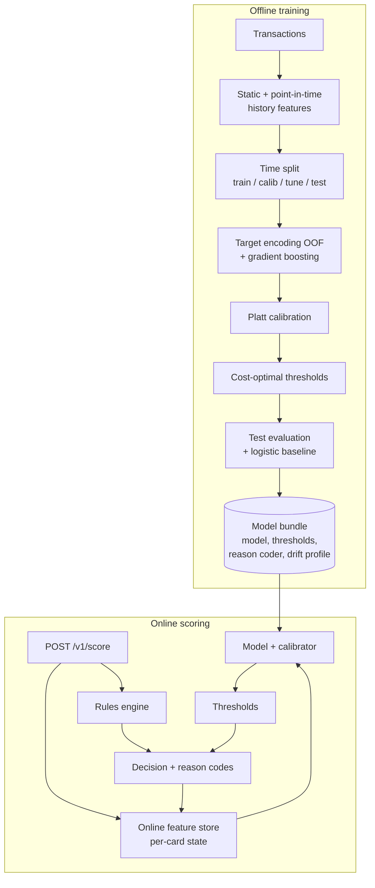

# Fraud Detection System

[](https://github.com/YOUR_GITHUB_USERNAME/fraud-detection-system/actions/workflows/ci.yml)


End-to-end card fraud detection, from raw transactions to a real-time scoring API. The parts that make fraud ML hard in production are treated as first-class code rather than notebook steps:

- **Point-in-time features** that never see the future, computed in batch for training and by an **online feature store** at request time, with tests that prove the two paths produce identical values.
- **Time-based evaluation** (train → calibrate → tune thresholds → test, all in chronological order).
- **Calibrated probabilities** and **cost-based decision thresholds** (approve / review / decline) that respect analyst capacity.
- A **rules engine** in YAML for patterns the model has not learned yet.
- **Reason codes** for every flagged transaction.
- **Drift monitoring** (PSI) against a reference profile stored inside the model bundle.
- A **FastAPI service** with batch scoring and Prometheus metrics, plus a **stream replay** tool that measures latency and business cost before deployment.

Works on the public [Kaggle credit card transactions dataset](https://www.kaggle.com/datasets/kartik2112/fraud-detection) (Sparkov simulator, ~1.85M transactions) or on the built-in generator, which produces the same schema with card-testing, account-takeover and impossible-travel fraud patterns.

## Architecture



## Quickstart

```bash
git clone https://github.com/YOUR_GITHUB_USERNAME/fraud-detection-system.git
cd fraud-detection-system
python -m venv .venv && source .venv/bin/activate
pip install -e ".[dev,lightgbm]"

make train      # synthetic data -> artifacts/<version>/ (bundle, metadata, model card)
make replay     # stream the test period through the online path; checks feature parity
make serve      # FastAPI on :8000, docs at http://localhost:8000/docs
make test
```

Score a transaction:

```bash
curl -s localhost:8000/v1/score -H 'content-type: application/json' -d '{
  "trans_num": "0b242abb623afc578575680df30655b9",
  "cc_num": "4613314721966",
  "ts": "2023-06-21T23:14:05",
  "amt": 812.47,
  "merchant": "fraud_Merchant_0042",
  "category": "shopping_net",
  "lat": 40.4931, "long": -91.8912,
  "merch_lat": 41.1012, "merch_long": -92.2210,
  "city_pop": 1306,
  "dob": "1968-03-19"
}'
```

```json
{
  "trans_num": "0b242abb623afc578575680df30655b9",
  "score": 0.91,
  "action": "decline",
  "model_action": "decline",
  "reasons": [
    {"feature": "amt", "description": "Transaction amount", "value": 812.47, "impact": 0.42},
    {"feature": "is_night", "description": "1 if hour is 22:00-05:59", "value": 1.0, "impact": 0.21}
  ],
  "rule_hits": [],
  "model_version": "20260115-101502-8c41d2",
  "latency_ms": 4.1
}
```
(The response above is illustrative; values depend on the trained model and the card's history.)

### On the Kaggle dataset

```bash
# put fraudTrain.csv and fraudTest.csv in data/raw/ (see data/README.md)
fraud-detect train --config configs/kaggle_sparkov.yaml
fraud-detect replay --config configs/kaggle_sparkov.yaml --limit 50000 --check-parity
```

Results from the synthetic generator are much easier than real fraud data and should not be quoted as model performance. Run on the Kaggle data (or your own) for meaningful numbers; every training run writes them to `artifacts/<version>/model_card.md`.

## How it works

### Features without leakage

All history features for a transaction at time *t* are computed from the card's events strictly before *t*: counts and sums over 1h / 24h / 7d, 30-day amount baseline (mean, std, z-score, ratio), time and distance since the previous transaction, implied travel speed, first use of a merchant, and transaction count so far. Static features cover amount, hour, night flag, cardholder age, home-to-merchant distance and city size. Merchant and category get smoothed target encodings; training rows receive out-of-fold values so their own label never leaks into their encoding.

The batch implementation (`features/history.py`) uses pandas time-window rolling; the online store (`features/online.py`) keeps a 30-day deque per card. `tests/test_feature_parity.py` streams thousands of transactions through both and requires identical results, including tricky cases like two transactions in the same second. Full catalogue: [docs/feature_catalog.md](docs/feature_catalog.md).

### Decisions are about cost, not accuracy
