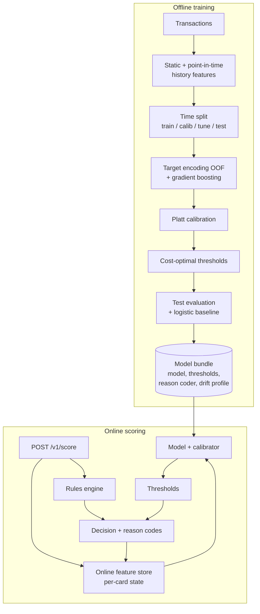

# Fraud Detection System

[](https://github.com/YOUR_GITHUB_USERNAME/fraud-detection-system/actions/workflows/ci.yml)


End-to-end card fraud detection, from raw transactions to a real-time scoring API. The parts that make fraud ML hard in production are treated as first-class code rather than notebook steps:

- **Point-in-time features** that never see the future, computed in batch for training and by an **online feature store** at request time, with tests that prove the two paths produce identical values.
- **Time-based evaluation** (train → calibrate → tune thresholds → test, all in chronological order).
- **Calibrated probabilities** and **cost-based decision thresholds** (approve / review / decline) that respect analyst capacity.
- A **rules engine** in YAML for patterns the model has not learned yet.
- **Reason codes** for every flagged transaction.
- **Drift monitoring** (PSI) against a reference profile stored inside the model bundle.
- A **FastAPI service** with batch scoring and Prometheus metrics, plus a **stream replay** tool that measures latency and business cost before deployment.

Works on the public [Kaggle credit card transactions dataset](https://www.kaggle.com/datasets/kartik2112/fraud-detection) (Sparkov simulator, ~1.85M transactions) or on the built-in generator, which produces the same schema with card-testing, account-takeover and impossible-travel fraud patterns.

## Architecture



## Quickstart

```bash
git clone https://github.com/YOUR_GITHUB_USERNAME/fraud-detection-system.git
cd fraud-detection-system
python -m venv .venv && source .venv/bin/activate
pip install -e ".[dev,lightgbm]"

make train      # synthetic data -> artifacts/<version>/ (bundle, metadata, model card)
make replay     # stream the test period through the online path; checks feature parity
make serve      # FastAPI on :8000, docs at http://localhost:8000/docs
make test
